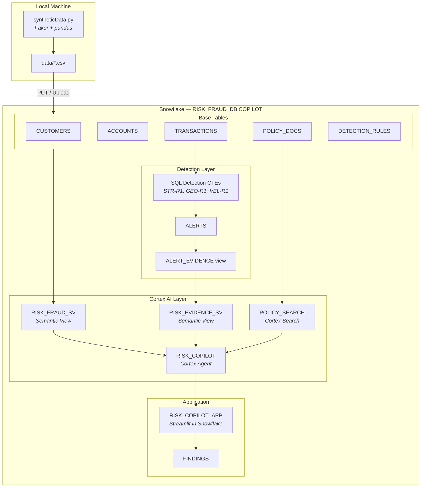

# Risk, Fraud & Regulatory Intelligence Copilot

A small tool that helps a bank's compliance team spot suspicious activity, understand why it was flagged, and write down a finding they can show to an auditor.

Built for the Snowflake hackathon. **All data in this project is fake (synthetic).** No real customers or transactions are used.

## What does it do?

1. **Creates fake banking data**: customers, accounts, about 50,000 transactions, and a set of written policies (for example, "what to do when cash deposits are just under the reporting limit").
2. **Flags suspicious activity** using simple rules, such as many cash deposits just below INR 10,00,000, or a very large transfer to a high-risk country.
3. **Answers questions in plain English**, for example: *"Which high-risk customers have structuring alerts?"* or *"What must we do when cash deposits are just below the reporting limit?"* Every answer points to the transactions and policy sections it came from.
4. **Saves a written finding** for each alert, with the evidence, the policy clauses, a risk summary and a recommended action. A person still has to review and sign it.

An alert is only a warning sign, not proof that someone did something wrong.

## Architecture



> Full diagrams (agent routing, detection flow, app tabs) are in [`docs/architecture.md`](docs/architecture.md).

## What it is built with

- **Snowflake** to store the data and run everything
- **Cortex Search** to look up policy text
- **Cortex Analyst** (with semantic views) to turn questions into SQL
- **Cortex Agent** to combine data and policy answers
- **Streamlit in Snowflake** for the web app
- **Python** (Faker and pandas) to create the fake data

## Before you start

You need:

- A Snowflake account where you can create a database, a warehouse and a role
- Python 3.11
- [uv](https://docs.astral.sh/uv/) (the Python package manager used here)
- Git

## Installation

```powershell
git clone <your-repo-url>
cd coco-risk-fraud-copilot
uv sync
```

`uv sync` creates a `.venv` folder and installs the packages listed in `pyproject.toml` (Faker and pandas).

If you prefer plain pip:

```powershell
python -m venv .venv
.venv\Scripts\Activate.ps1
pip install faker pandas
```

## Setup, step by step

### 1. Create the fake data

Run this from the project folder (the CSV files are written to a `data` folder next to where you run it):

```powershell
uv run python syntheticData.py
```

You should see four files in `data/`: `customers.csv`, `accounts.csv`, `transactions.csv` and `policy_docs.csv`.

### 2. Set up Snowflake

Open a SQL worksheet in Snowsight and run the SQL files in this order:

| Order | File | What it does |
|---|---|---|
| 1 | `sql/01-setup.sql` | Creates the role, warehouse, database `RISK_FRAUD_DB`, schema `COPILOT`, the tables (with constraints), the masking policy on customer names, and the policy search service. You upload the four CSV files to the stage and load them here. |
| 2 | `sql/02-alerts.sql` | Runs the detection rules to create the `ALERTS` table, the `ALERT_EVIDENCE` view, and the main semantic view `RISK_FRAUD_SV`. |
| 3 | `sql/03-agent.sql` | Creates the evidence semantic view `RISK_EVIDENCE_SV` and the `RISK_COPILOT` agent. |
| 4 | `sql/04-findings.sql` | Creates the `FINDINGS` table where saved findings are stored. |

Tip: after each file, run the check queries at the bottom of it before moving on.

### 3. Run the app

This app runs **inside Snowflake** (Streamlit in Snowflake). It uses the Snowflake session of the person who is signed in, so the command `streamlit run streamlit_app.py` on your own computer will **not** work.

**Option A — Deploy via SQL** (recommended):

```sql
CREATE STAGE IF NOT EXISTS RISK_FRAUD_DB.COPILOT.STREAMLIT_STAGE
  ENCRYPTION = (TYPE = 'SNOWFLAKE_SSE');

PUT 'file:///path/to/streamlit_app.py' @RISK_FRAUD_DB.COPILOT.STREAMLIT_STAGE
  AUTO_COMPRESS=FALSE OVERWRITE=TRUE;

CREATE OR REPLACE STREAMLIT RISK_FRAUD_DB.COPILOT.RISK_COPILOT_APP
  ROOT_LOCATION = '@RISK_FRAUD_DB.COPILOT.STREAMLIT_STAGE'
  MAIN_FILE = 'streamlit_app.py'
  QUERY_WAREHOUSE = 'RISK_WH'
  TITLE = 'Risk & Compliance Copilot';

GRANT USAGE ON STREAMLIT RISK_FRAUD_DB.COPILOT.RISK_COPILOT_APP
  TO ROLE RISK_COPILOT_ROLE;
```

**Option B — Manual via Snowsight:**

1. In Snowsight, go to **Projects → Streamlit** and click **+ Streamlit App**.
2. Choose database `RISK_FRAUD_DB`, schema `COPILOT` and warehouse `RISK_WH`. The schema matters, because the app looks for the agent there.
3. Replace the starter code with the contents of `streamlit_app.py`.
4. Click **Run**.

## Using the app

The app has three tabs:

- **Alert queue**: all alerts, with filters for severity and rule, plus a few totals.
- **Case view & finding**: pick an alert to see the customer, the transactions behind it and the policy sections that apply. Choose a disposition, add notes, and click **Generate finding** to save it to the `FINDINGS` table and download it.
- **Ask the copilot**: type a question and the agent answers using the data and the policies. Example questions are in the sidebar.

## Project structure

```
coco-risk-fraud-copilot/
├── syntheticData.py       # Creates the fake CSV data
├── generate_data.py       # Older generator (superseded by syntheticData.py)
├── policy_docs.py         # The written policies (split into small sections)
├── streamlit_app.py       # The web app (runs inside Snowflake)
├── sql/
│   ├── 01-setup.sql       # Role, warehouse, DB, tables, masking policy, Cortex Search
│   ├── 02-alerts.sql      # Detection rules, ALERTS, ALERT_EVIDENCE, semantic view
│   ├── 03-agent.sql       # Evidence semantic view and the Cortex Agent
│   └── 04-findings.sql    # FINDINGS table for saved reports
├── eval/
│   └── agent_eval_set.json # 26 ground-truth questions for agent accuracy testing
├── docs/
│   └── architecture.md    # Full Mermaid architecture diagrams
├── data/                  # Generated CSV files (created by syntheticData.py)
├── pyproject.toml         # Python dependencies
├── uv.lock                # Exact dependency versions
├── .python-version        # Python version (3.11)
└── README.md
```

## About the rules and policies

- The policies, thresholds and country list are made up for this project. The regulatory references are examples and should be checked against official sources before being used anywhere real.
- Three rules are implemented:
  - `STR-R1`: 3 or more cash deposits between INR 9,00,000 and INR 9,99,999 within 7 days
  - `GEO-R1`: one transfer above INR 20,00,000 to a listed high-risk country
  - `VEL-R1`: more than 15 transfers within 60 minutes
- The rules follow the written policy exactly. For example, a burst of exactly 15 transfers is not flagged, because the policy says "more than 15".

## Troubleshooting

- **`uv sync` or `uv add` complains about `policy-docs`**: `policy_docs.py` is a local file, not a package. Remove any `policy-docs` line from `dependencies` in `pyproject.toml`.
- **`ModuleNotFoundError: No module named 'policy_docs'`**: keep `policy_docs.py` in the same folder as `syntheticData.py`.
- **CSV load fails with "Date 'effective_date' is not recognized"**: the file format must skip the header row (`SKIP_HEADER = 1`).
- **App says the agent is not found**: create the Streamlit app in database `RISK_FRAUD_DB`, schema `COPILOT`.

## Future improvements

- [x] Hide customer names for junior roles (masking policy) and show the same alert under two roles
- [ ] Remove the mention of rule `STR-R2` from policy `POL-001-S3`, or build that rule (it is not implemented yet)
- [ ] Store rule thresholds in the `DETECTION_RULES` table so changing a row changes the alerts
- [x] Add a test set of questions to measure how often the agent answers correctly
- [ ] Add a reviewer sign-off step that changes a finding from DRAFT to APPROVED
- [ ] Add a version of the app that can run on a laptop
- [x] Add an architecture diagram and a demo video link here

## Disclaimer

This is a hackathon project for learning and demonstration. It uses synthetic data only and is not legal or compliance advice.